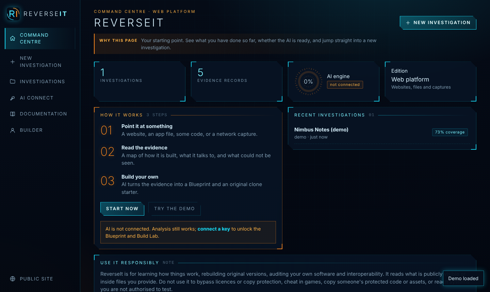
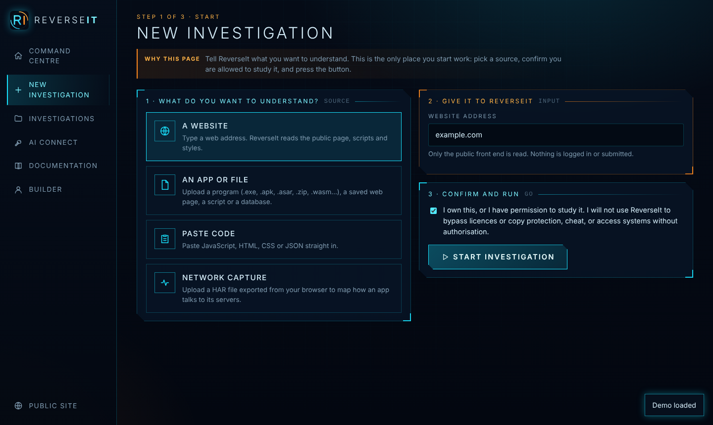
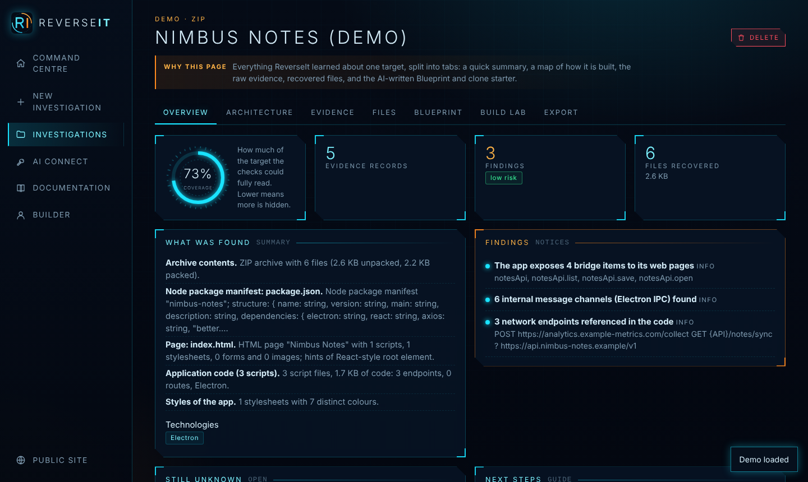
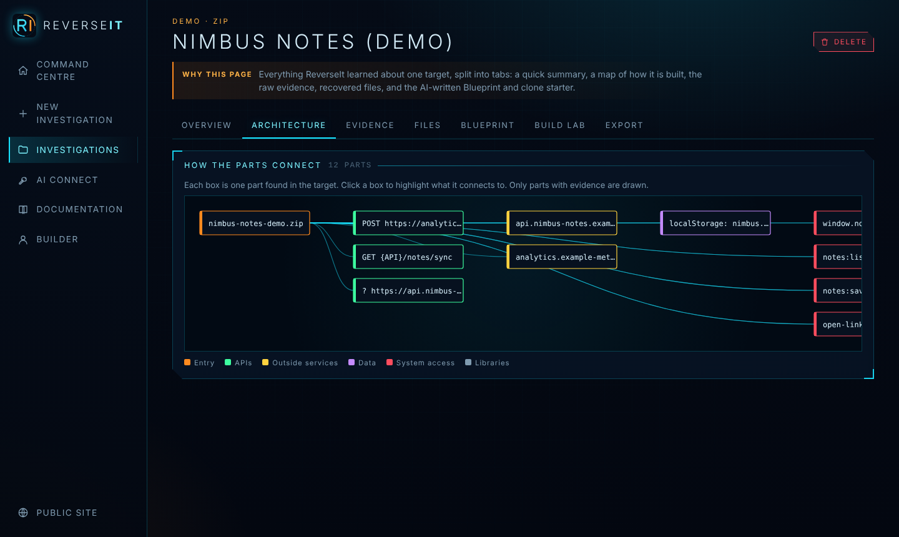
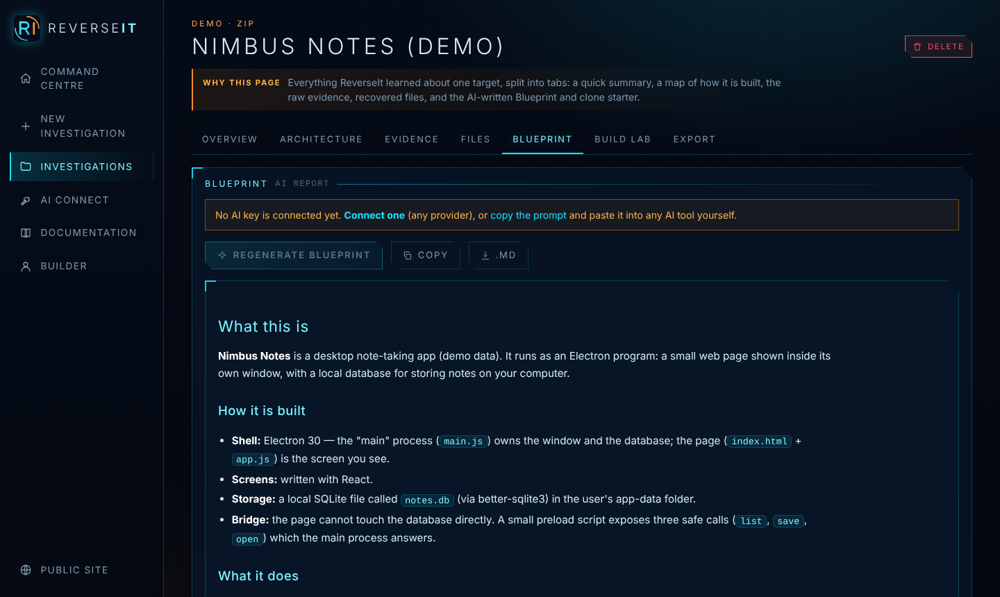
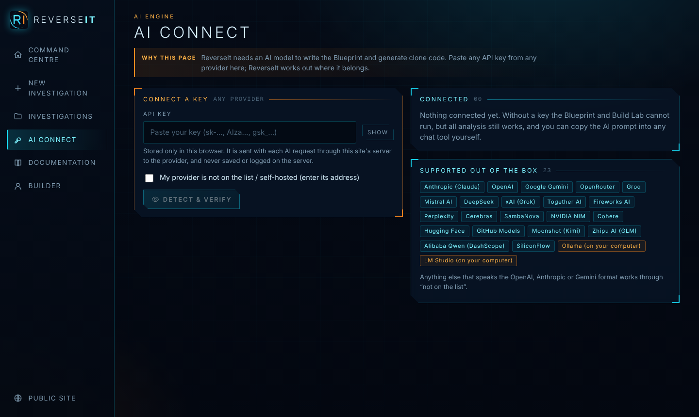

<div align="center">


# R E V E R S E I T

**Take it _apart_. Build it _yours_.**

ReverseIt reads websites, apps and programs, shows you how they are built,<br/>
and helps you rebuild your own original version — no technical knowledge needed.

<br/>

[**⚡ Open the Dashboard**](https://reverseit.vercel.app/app) &nbsp;·&nbsp; [**Live site**](https://reverseit.vercel.app/) &nbsp;·&nbsp; [**Read the docs**](https://reverseit.vercel.app/docs)

`Open source` &nbsp; `No accounts` &nbsp; `Bring your own AI` &nbsp; `MIT`

<br/>

<a href="https://reverseit.vercel.app/"></a>

</div>

<br/>

> **Needs an AI API key** for the Blueprint and Build Lab — from *any* provider. Analysis itself works without one.

---

## ▌ HOW IT WORKS &nbsp;`3 STEPS`

| | | |
|:--|:--|:--|
| **01 · Point it at something** | **02 · Read the evidence** | **03 · Build your own** |
| A website, an app file, some code, or a network capture. Confirm you are allowed to study it. | ReverseIt inspects it and draws the architecture, listing findings, coverage and unknowns. | AI writes the Blueprint and generates an original clone starter you can download and run. |

---

## ▌ WHAT IT BUILDS

*Everything between “how does this work?” and “I built it”.*

| Module | What it does |
|---|---|
| 🌐 **Read any website** | Enter an address. ReverseIt reads the public page, scripts and styles, finds API calls, technologies, fonts and colours — and recovers original sources from public source maps. |
| 📦 **Open apps and files** | Windows, Linux, macOS, Android, Electron, WebAssembly, archives and databases — read for structure, libraries and behaviour. |
| 🕸️ **See the architecture** | A clear map of the parts and how they connect, with honest coverage and a list of what could not be seen. |
| 📄 **Blueprint in plain words** | AI turns the evidence into a report anyone can read: what it is, how it works, risks and a rebuild plan. |
| 🧱 **Build your own version** | Generate an original, runnable clone starter, an API with mock server, or a full design system — as a zip. |
| 🔑 **Any AI, your key** | Paste a key from any provider. ReverseIt works out where it belongs. |

---

## ▌ SHOWCASE &nbsp;`SEE IT WORKING`

<table>
<tr>
<td width="50%"><br/><sub><b>Start an investigation</b></sub></td>
<td width="50%"><br/><sub><b>Overview and findings</b></sub></td>
</tr>
<tr>
<td><br/><sub><b>Architecture map</b></sub></td>
<td><br/><sub><b>AI Blueprint</b></sub></td>
</tr>
<tr>
<td colspan="2"><br/><sub><b>Connect any AI key</b></sub></td>
</tr>
</table>

---

## ▌ AI KEY &nbsp;`REQUIRED FOR AI FEATURES`

ReverseIt has no accounts and no hidden AI bill. For the Blueprint and Build Lab you connect **your own** API key from **any** provider — OpenAI, Anthropic, Google, OpenRouter, Groq, Mistral, DeepSeek, xAI, Together, Fireworks, Perplexity, Cerebras, SambaNova, NVIDIA, Cohere, Hugging Face, GitHub Models, Moonshot, Zhipu, Qwen, SiliconFlow, or your own server through a custom base URL.

Anything that speaks the OpenAI, Anthropic or Gemini API format works. The key lives only in your browser and travels with each request; it is never stored or logged. A key is only sent to the provider whose key format matches, unless you explicitly choose *try every provider*.

## ▌ HONEST BY DESIGN &nbsp;`LIMITS`

Every result says how complete it is and what it could not see.

- ReverseIt **reads and measures; it never runs** the target.
- It cannot see server code, databases or anything behind a login.
- Native programs get a structural read (layout, imports, strings). Full decompiling needs a dedicated tool such as Ghidra, IDA or Hopper.
- Minified code limits what can be named; published source maps restore a lot.
- AI output can be wrong — check it against the evidence.
- A clone reproduces observable behaviour and design, not hidden internals or data.

**Use it responsibly.** Learn, audit software you own, do authorised security and interoperability work, and build original products. Do not use it to bypass licences or copy protection, to cheat, to access systems without permission, or to copy someone's protected code, text, images or brand.

---

## ▌ DEPLOY YOUR OWN &nbsp;`3 STEPS`

1. Upload this repository to GitHub.
2. Import it at [vercel.com/new](https://vercel.com/new). Leave every setting at its default — no build command, no environment variables.
3. Press **Deploy**. Landing page at `/`, the platform at `/app`.

No login, no database. The server functions are stateless proxies and every visitor brings their own key.

```
public/        the website and dashboard (prebuilt)
api/           stateless serverless functions
source/        full source code and build script
vercel.json    routing, 60 s function limit, security headers
```

Rebuild from source (optional):

```bash
cd source
npm install
npm run build     # writes ../public and ../api
```

> Heads-up for hosting: the free Vercel tier limits function time, so very large websites may be only partly read. The website reader and AI proxy are open to your visitors by design (no auth) — enable Vercel's rate limiting if you see abuse.

---

## ▌ THE BUILDER

<table>
<tr>
<td width="140"></td>
<td>

**Bharat Wagh** · 21<br/>
Curious builder, always open to new ideas and innovation. Currently a Computer Engineering student at TSSM's Padmabhooshan Vasantdada Patil Institute of Technology, Bavdhan, Pune — passionate about tech and how it works.<br/>
**Freelance:** need something built? Connect on LinkedIn.

[LinkedIn](https://www.linkedin.com/in/bharat-wagh-96b3082a8) · [GitHub](https://github.com/Bharat2456) · [Instagram](https://www.instagram.com/doppelganger.bharat) · [X](https://x.com/BharatWagh1010)

</td>
</tr>
</table>

---

<div align="center">

**[reverseit.vercel.app](https://reverseit.vercel.app/)** · MIT License · © Bharat Wagh

</div>
